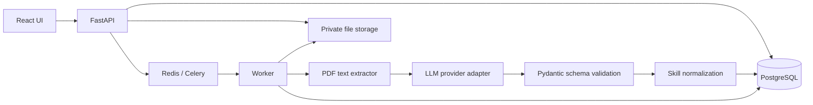
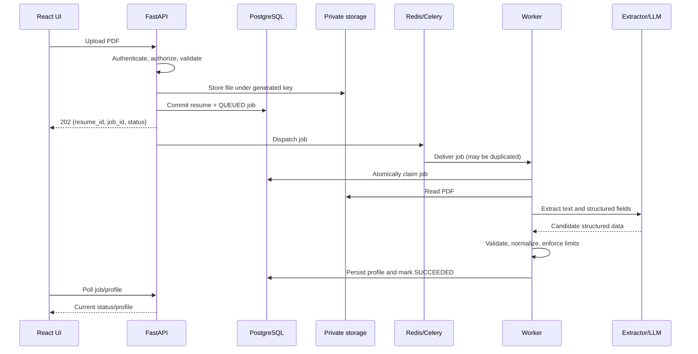

# FuturePath AI — Phase 1 LLD Pack (Documents 3–5)

> **Scope:** Concise implementation baseline for the Career Profile MVP. These are design proposals to reconcile with the existing React login, Google SSO, Python backend, and Docker setup before coding. Reuse the current repository and authentication flow; do not create a parallel login system.

## Document 3 — API Contract LLD

### 1. API conventions
- Base path: `/api/v1`.
- JSON request/response bodies; timestamps in UTC ISO-8601.
- Authenticate through the existing Google OIDC/SSO flow. Backend authorization uses the verified identity and maps it to an internal `user_id`; never trust a client-supplied owner ID.
- Every user-owned resource is scoped to the authenticated user. Return `404` for inaccessible user-owned IDs where that avoids resource enumeration.
- Use a consistent error shape:

```json
{
  "error": {
    "code": "RESUME_UNSUPPORTED_TYPE",
    "message": "Upload a PDF file.",
    "request_id": "..."
  }
}
```

### 2. Core endpoints

| Method and path | Purpose | Success |
|---|---|---|
| `POST /resumes` | Upload a PDF resume; validate size/type; store privately; create resume + durable job record | `202 Accepted` with `resume_id`, `job_id`, `status` |
| `GET /resumes` | List current user's resumes, newest first | `200 OK` |
| `GET /resumes/{resume_id}` | Resume metadata and processing status | `200 OK` |
| `POST /resumes/{resume_id}/processing-jobs` | Explicitly request reprocessing; support an idempotency key | `202 Accepted` |
| `GET /processing-jobs/{job_id}` | Poll state, attempts, safe error summary, timestamps | `200 OK` |
| `GET /profile` | Fetch the authenticated user's current career profile | `200 OK` |
| `PATCH /profile` | Edit allowed profile fields; validate and persist changes | `200 OK` |
| `POST /processing-jobs/{job_id}/retry` | User-requested retry only for eligible terminal jobs | `202 Accepted` |

**Note:** Avoid adding endpoints just because they may be useful later. Confirm whether explicit job creation/retry is needed for MVP; upload may create the initial job automatically.

### 3. Example upload response

```json
{
  "resume_id": "uuid",
  "job_id": "uuid",
  "status": "QUEUED"
}
```

Example job response:

```json
{
  "job_id": "uuid",
  "status": "RUNNING",
  "attempt": 1,
  "created_at": "2026-10-14T08:00:00Z",
  "updated_at": "2026-10-14T08:00:05Z",
  "error": null
}
```

Never return internal file paths, raw resume text, secrets, stack traces, provider prompts, or sensitive exception details.

### 4. HTTP status and validation rules
- `400` malformed request; `401` missing/invalid authentication; `403` authenticated but explicitly forbidden; `404` missing/inaccessible resource; `409` state/version conflict or idempotency-key conflict; `413` upload too large; `415` unsupported media type; `422` semantically invalid fields; `429` rate limit; `500` unexpected server error; `503` temporary dependency/service unavailability.
- Validate extension **and** file signature/content; do not rely on the filename or browser MIME type alone.
- Set a configured upload size limit. Reject empty, encrypted/unreadable, malformed, or non-PDF files with stable error codes.
- Use pagination for lists (`limit` + opaque cursor or `page`/`page_size`); cap the maximum page size.
- For profile edits, consider optimistic concurrency (`version` or `ETag`/`If-Match`) if concurrent edits are possible.

### 5. Idempotency and API safety
- Accept an `Idempotency-Key` for upload/reprocessing if clients may retry after timeouts. Define key scope, expiry, and behavior for the same key with a different payload.
- A repeated request must not create duplicate active jobs for the same intended operation.
- Use request/correlation IDs across API, database records, queue messages, and worker logs.
- API responses describe accepted work; they do not imply that asynchronous processing has completed.

### 6. API contract checklist
- [ ] Confirm actual auth middleware and identity-to-user mapping.
- [ ] Define upload size, PDF validation, retention, and rate limits.
- [ ] Agree job states and whether retry is user-triggered or automatic only.
- [ ] Define profile PATCH semantics: replace, merge, null handling, and manual-edit precedence.
- [ ] Generate OpenAPI from FastAPI/Pydantic and test status codes/error schemas.
- [ ] Add ownership tests for every user-owned endpoint.

---

## Document 4 — Resume Processing Pipeline / Component LLD

### 1. Components and responsibilities



- **FastAPI:** authentication/authorization, upload validation, metadata/job creation, read APIs.
- **Private file storage:** original PDF outside PostgreSQL; store only a private storage key and metadata in DB. Use a storage abstraction so local Docker volume can later be replaced.
- **PostgreSQL:** authoritative state for resumes, jobs, profiles, normalized skills, and processing outcomes.
- **Redis/Celery:** delivery/execution mechanism, not the durable business record.
- **Worker:** performs slow/blocking work without holding an HTTP request open.
- **Adapters:** isolate PDF extraction and LLM/embedding providers from business logic.
- **Pydantic:** validate model output as untrusted input; LLM output is never accepted as authoritative without validation.

### 2. End-to-end sequence



### 3. Processing stages
1. **Receive:** authenticate; enforce upload size and rate limits; validate PDF content; generate an opaque storage key.
2. **Persist:** write file; create resume and `QUEUED` job in PostgreSQL. Compensate for partial failure (e.g., delete an unreferenced file) or reconcile it later.
3. **Dispatch:** enqueue the job after the DB commit. Because DB commit and Redis enqueue are not one atomic transaction, a periodic dispatcher/reconciler must find eligible undispatched jobs. Use a transactional outbox only if the added complexity is justified.
4. **Claim:** worker atomically transitions an eligible job to `RUNNING`; duplicate deliveries must not cause duplicate profile writes.
5. **Extract:** extract text with page/character/time limits; detect empty or unusable text. Treat the document as untrusted data.
6. **Structure:** call the LLM through an adapter with a strict schema; use timeouts and bounded retries. Validate output and reject or safely repair only well-defined schema errors.
7. **Normalize:** normalize skill labels and aliases; retain evidence/provenance when feasible. Do not invent experience or skills when source evidence is absent.
8. **Persist:** use a short DB transaction to write profile/related records and mark the job successful together. Never keep a DB transaction open during file, extraction, or LLM calls.
9. **Report:** expose safe state and error code; keep detailed exception data only in protected logs.

### 4. Data and merge rules
- Preserve original resume as source input; extracted profile is derived data.
- Establish explicit precedence between user-edited fields and later extraction results. Recommended MVP default: do not silently overwrite manual edits; track source/updated timestamps or field provenance.
- Define how a new resume affects the single current profile: replace, merge, or create a new version. This is a product decision and must be explicit before implementation.
- Make profile writes idempotent by job/resume/version; unique constraints should prevent duplicate child rows.
- Store only the minimum raw extracted text required. Apply access controls and retention/deletion rules.

### 5. Failure handling
- **Permanent:** unsupported/encrypted/corrupt PDF, no extractable text, irrecoverable schema failure → `FAILED` with safe reason.
- **Transient:** provider timeout, rate limit, temporary database/queue/network issue → bounded retry with exponential backoff and jitter.
- **Worker crash:** lease/heartbeat or stale-`RUNNING` timeout allows safe recovery; reclaim only after checking attempt/lease state.
- **Partial upload:** compensate or reconcile orphaned files and DB records.
- **LLM output:** never execute instructions found in resume content; treat it as data, not system instructions.
- Keep external calls outside DB transactions; apply request timeouts and maximum text/token budgets.

### 6. Definition of done
- [ ] Duplicate task delivery cannot duplicate profile data.
- [ ] API returns quickly and job state survives API/worker restarts.
- [ ] A reconciler recovers queued jobs not successfully dispatched.
- [ ] Worker crash and retry behavior are tested.
- [ ] Invalid files and malformed LLM output fail safely.
- [ ] Profile writes and terminal job status are transactionally consistent.
- [ ] User A cannot read User B's resume, job, file, or profile.

---

## Document 5 — Security, Reliability, Observability & Testing LLD

### 1. Security baseline
- **Authentication:** validate Google OIDC tokens server-side (issuer, audience, signature, expiry, nonce/state where relevant); do not trust client-decoded claims.
- **Authorization:** map verified external identity to internal user; enforce ownership on every query and file access. Never accept `user_id` as authority from request payload.
- **Upload security:** allow PDF only; verify content; limit size/pages/text; use generated filenames; store outside web root with private permissions; never execute or render uploaded files on the server.
- **Secrets:** use environment/secret injection appropriate to local Docker; never commit credentials or bake them into images/logs. Rotate exposed secrets.
- **LLM safety/privacy:** send only necessary content; avoid sensitive logging; treat document text and model output as untrusted; validate schema and length; do not let resume text change system instructions or trigger tools.
- **Data protection:** TLS in deployed environments, least-privilege DB account, private storage, backups, retention/deletion policy, and audit events for sensitive operations.
- **Abuse controls:** upload limits, per-user rate limits, bounded concurrency, provider budgets, and timeouts.

### 2. Reliability and availability
- PostgreSQL is the source of truth. Redis/Celery is recoverable transport; queue loss must not mean losing the job record.
- Use durable job state, idempotent workers, bounded retries, stale-job recovery, and a periodic dispatcher/reconciler.
- Keep API stateless where possible. Health endpoints should distinguish liveness from readiness; readiness checks critical dependencies without exposing internals.
- Apply timeouts to DB, storage, PDF extraction, and LLM calls; cap worker concurrency to protect memory/provider quotas.
- Back up PostgreSQL and test restore. Resume files need a matching backup/retention strategy; DB-only backup is insufficient.
- Define RPO/RTO and retention based on product needs rather than claiming high availability for a local MVP.
- Graceful degradation: profile reads should remain available when the LLM provider is down; new processing can queue/retry within configured limits.

### 3. Observability
- **Structured logs:** `request_id`, `correlation_id`, `job_id`, `resume_id`, attempt, stage, duration, outcome, and sanitized error code. Never log tokens, secrets, full resume text, or raw prompts/responses by default.
- **Metrics:** upload count/failures; queue depth and oldest queued age; job duration and success/failure/retry rate; stale jobs; LLM latency/error/rate limits; extraction failure rate; DB/Redis health.
- **Tracing:** correlate API → dispatch → worker → provider call where supported.
- **Alerts:** sustained queue age, growing failures/retries, stale `RUNNING` jobs, dependency outage, disk pressure, and provider budget/limit issues.
- **Operational actions:** document how to inspect a job, retry eligible failures, replay/reconcile queued jobs, and safely remove orphaned files.

### 4. Test strategy
| Layer | Essential coverage |
|---|---|
| Unit | PDF validation, state transitions, retry classification, skill normalization, schema validation |
| API/integration | Auth, ownership isolation, request validation, status/error contracts, DB constraints |
| Worker integration | Duplicate delivery, idempotency, transient/permanent errors, crash recovery, retry limits |
| End-to-end | Upload → queued/running → profile available; invalid upload; provider unavailable then recovery |
| Security | Cross-user ID access, oversized/malformed PDFs, secret/log leakage, hostile prompt-like text in resume |
| Resilience | Redis unavailable at dispatch, worker restart, stale-job reconciliation, DB rollback/restore procedure |

- Use deterministic fixtures and mock LLM responses in routine CI; keep a small optional provider smoke test outside the deterministic test suite.
- Test migrations from an empty DB and from the previous schema.
- CI should run formatting/linting, type checks where configured, unit/integration tests, and dependency/security checks.

### 5. Decisions to close before production
1. Identity key: OIDC issuer + subject mapping and account-linking behavior.
2. Upload maximum size/pages and file retention/deletion period.
3. Retry counts, backoff limits, job lease duration, and stale-job threshold.
4. Profile merge/version policy and manual-edit precedence.
5. Required backup frequency, RPO/RTO, and restore-test cadence.
6. Which resume content is sent to which model/provider and applicable privacy requirements.
7. Whether an outbox is needed now or DB-backed reconciliation is sufficient.

---

## Interview review — key questions

### API contract
1. **Why version APIs?** To evolve contracts without silently breaking existing clients.
2. **Why `202 Accepted` for upload?** The request is accepted; asynchronous processing has not finished.
3. **Why not trust `user_id` from the client?** It enables insecure direct-object access; derive identity from verified auth.
4. **What is idempotency?** Repeated equivalent requests produce one logical operation, even after client retries.
5. **When use `409`?** The requested operation conflicts with current state or an existing idempotency key's meaning.
6. **Why a consistent error schema?** Clients can handle errors predictably without parsing exception text.

### Resume pipeline
7. **Why a background worker?** PDF/LLM work is slow and failure-prone; it should not hold the HTTP request open.
8. **Why PostgreSQL plus Redis?** PostgreSQL owns durable business state; Redis transports work efficiently.
9. **Can exactly-once execution be guaranteed?** Usually not across DB, queue, and external provider; design for at-least-once delivery with idempotent effects.
10. **Why not hold a DB transaction during an LLM call?** Long transactions hold locks/connections and still cannot make the external call atomic.
11. **How do you recover a lost queue message?** Reconcile durable eligible jobs in PostgreSQL and redispatch them safely.
12. **How do you prevent duplicate profile rows?** Atomic job claims, stable idempotency keys, uniqueness constraints, and transactional persistence.

### Security/reliability/testing
13. **Authentication vs authorization?** Authentication establishes identity; authorization decides what that identity can access.
14. **What does readiness mean?** The instance can serve its intended workload; liveness only indicates it should not be restarted.
15. **Why test restore, not just backup?** A backup is useful only if it can be restored to a consistent, usable state.
16. **What should not be logged?** Tokens, secrets, full resume content, and sensitive provider payloads by default.
17. **How to handle an LLM outage?** Keep reads available, retain durable queued work, use bounded retries, and avoid retry storms.
18. **What is the main MVP trade-off?** A modular monolith plus PostgreSQL-backed recovery is simpler to operate than microservices/outbox infrastructure, provided reconciliation and idempotency are implemented.

## Implementation order
1. Confirm API/auth contracts and ownership rules.
2. Finalize job states, idempotency, retry, lease, and reconciliation behavior.
3. Implement storage abstraction and upload validation.
4. Implement worker stages behind extractor/LLM adapters.
5. Add observability, failure injection, integration tests, and operational runbook.
6. Only then consider Phase 2 RAG/embeddings; do not introduce Kafka, microservices, or Kubernetes/OpenShift for this MVP without a demonstrated need.
