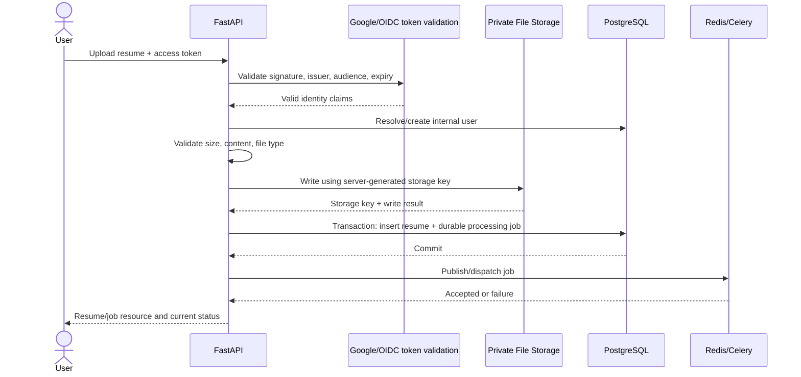
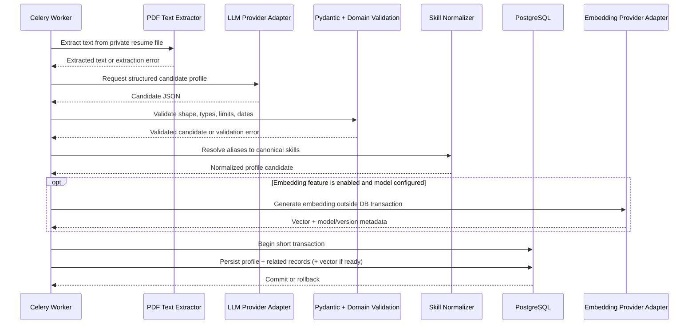
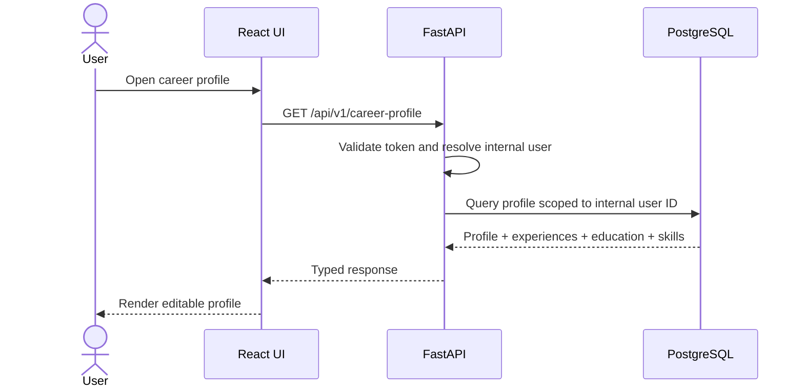

# FuturePath AI — Phase 1 Database Low-Level Design (LLD)

**Document status:** Design baseline  
**Phase:** Phase 1 — Career Profile MVP  
**Version:** 1.0  
**Last updated:** 2026-10-14  
**Owner:** FuturePath AI project  
**Repository path:** `docs/architecture/phase-1-database-lld.md`

---

## 1. Purpose

This document defines the database design for the FuturePath AI Phase 1 Career Profile MVP. It records the selected approach, logical data model, proposed PostgreSQL schema, constraints, indexes, transaction boundaries, failure handling, security controls, and the decisions that must be finalized before migrations are written.

It is intended to serve two purposes:

1. An implementation reference for the project repository.
2. A system-design interview study document that explains not only *what* was chosen, but *why*, the alternatives considered, and the trade-offs.

This is a **design baseline**, not a claim that SQLAlchemy models or Alembic migrations have already been implemented.

## 2. Scope and non-goals

### In scope

- User identity mapping for authenticated application users.
- Resume metadata and references to privately stored source files.
- Processing-job records associated with resumes.
- A user's current career profile.
- Work experience and education records.
- Canonical skills, skill aliases, profile-skill associations, and evidence.
- Versioned profile embeddings where a concrete Phase 1 use case justifies them.
- Primary/foreign keys, uniqueness and check constraints, indexes, transaction boundaries, retention, and security.
- Database interactions with the API, background workers, file storage, Redis/Celery, and AI providers.

### Explicitly out of scope for Phase 1

- Job-market ingestion and job matching.
- A full Retrieval-Augmented Generation (RAG) pipeline.
- Agent workflows and MCP.
- Kafka or a separate event-streaming platform.
- A dedicated vector database.
- Microservices or database-per-service.
- Kubernetes/OpenShift deployment.
- Multi-region active-active database architecture.

These may be considered in later roadmap phases when requirements and measured limitations justify them.

## 3. Architecture context

The Phase 1 application is a **modular monolith**. The API and worker can be separate processes/containers while sharing the same application codebase and PostgreSQL database.

### Selected technology baseline

| Concern | Baseline decision | Rationale |
|---|---|---|
| Frontend | React-based UI already being developed | Reuse the colleague's existing login/UI work; confirm whether the repository uses Next.js or another React setup before integrating |
| API | Python + FastAPI | Fits the AI/document-processing workflow and provides typed request/response validation |
| Schema validation | Pydantic | Validates API payloads and structured extraction output |
| System of record | PostgreSQL | ACID transactions, relational constraints, mature operations, and support for pgvector when justified |
| ORM and migrations | SQLAlchemy + Alembic | Explicit model mapping and version-controlled schema evolution |
| Async processing | Redis + Celery | Moves slower resume processing out of the request path |
| Original resume files | Private local Docker-mounted storage for development, behind a storage abstraction | Keeps binary files out of relational tables and allows later object-storage adoption |
| Embeddings | PostgreSQL + pgvector only after use case/model/dimensions are finalized | Avoid premature indexing or an unnecessary vector service |
| Local execution | Docker / Docker Compose, aligned with the existing working image | Reproducible local development |
| CI | GitHub Actions baseline | Automated tests and quality checks |

**Integration note:** A colleague has already implemented a React login page, Python backend work, registered a Google SSO application, built a Docker image, and run the project locally. This database design must be integrated with that existing code rather than assuming a blank repository. Before implementation, inspect the actual folder structure, current Python framework, environment variables, authentication callback/token flow, Dockerfile, and Compose configuration. Do not create a second login flow or duplicate identity-provider registration without a concrete reason.

## 4. Design principles

1. **PostgreSQL is authoritative for business state.** Redis messages, worker memory, and LLM responses are not the source of truth.
2. **Store files outside the relational database.** PostgreSQL stores file metadata and a private storage key, not the PDF bytes.
3. **Normalize data that needs integrity and querying.** Experiences, education, skills, and aliases are separate relational records.
4. **Treat AI output as untrusted candidate data.** Validate and normalize it before persistence.
5. **Commit related profile data atomically.** A profile update must not leave half the experiences or skills written.
6. **Keep derived data rebuildable.** Embeddings are derived artifacts and should be reproducible from source/profile content and a recorded model version.
7. **Design for duplicate delivery.** Celery jobs may be delivered or retried more than once.
8. **Use ownership checks everywhere.** A UUID is an identifier, not proof of authorization.
9. **Make schema evolution explicit.** Use Alembic migrations, constraints, tests, and a rollback/forward-fix plan.
10. **Do not add infrastructure prematurely.** No separate vector database, Kafka, or database-per-service for this MVP.

## 5. Logical data model

### 5.1 Entity relationship diagram

```mermaid
erDiagram
    USERS ||--o{ RESUMES : uploads
    USERS ||--o| CAREER_PROFILES : owns
    RESUMES ||--o{ PROCESSING_JOBS : has
    CAREER_PROFILES ||--o{ EXPERIENCES : contains
    CAREER_PROFILES ||--o{ EDUCATION_RECORDS : contains
    CAREER_PROFILES ||--o{ PROFILE_SKILLS : lists
    SKILLS ||--o{ PROFILE_SKILLS : normalized_as
    PROFILE_SKILLS ||--o{ SKILL_EVIDENCE : supported_by
    SKILLS ||--o{ SKILL_ALIASES : has
    CAREER_PROFILES ||--o{ PROFILE_EMBEDDINGS : represented_by

    USERS {
        uuid id PK
        text external_subject UK
        timestamptz created_at
        timestamptz updated_at
    }
    RESUMES {
        uuid id PK
        uuid user_id FK
        text storage_key UK
        char sha256
        bigint size_bytes
        text status
        timestamptz uploaded_at
    }
    PROCESSING_JOBS {
        uuid id PK
        uuid resume_id FK
        text idempotency_key
        text status
        int attempt_count
        text last_error_code
        timestamptz created_at
        timestamptz started_at
        timestamptz finished_at
    }
    CAREER_PROFILES {
        uuid id PK
        uuid user_id FK_UK
        text headline
        text summary
        int version
        timestamptz created_at
        timestamptz updated_at
    }
    EXPERIENCES {
        uuid id PK
        uuid profile_id FK
        text employer
        text job_title
        date start_date
        date end_date
    }
    EDUCATION_RECORDS {
        uuid id PK
        uuid profile_id FK
        text institution
        text qualification
        date start_date
        date end_date
    }
    SKILLS {
        uuid id PK
        text canonical_name UK
        text category
    }
    SKILL_ALIASES {
        uuid id PK
        uuid skill_id FK
        text alias
        text normalized_alias UK
    }
    PROFILE_SKILLS {
        uuid id PK
        uuid profile_id FK
        uuid skill_id FK
        text proficiency
        text source_type
    }
    SKILL_EVIDENCE {
        uuid id PK
        uuid profile_skill_id FK
        text source_type
        text source_reference
    }
    PROFILE_EMBEDDINGS {
        uuid id PK
        uuid profile_id FK
        text model_id
        text content_hash
        vector embedding
    }
```

**Relationship note:** The diagram uses a generic `vector` label for readability. The actual pgvector column type must use a specific dimension, such as `vector(n)`, when the embedding model and dimensionality are selected. Do not create a production vector index around an unspecified dimension.

### 5.2 Relationship rules

- A user can upload many resumes.
- In the MVP, a user has at most one current career profile. The unique constraint on `career_profiles.user_id` enforces this.
- A resume can have multiple processing-job records over its lifecycle, for example, a deliberate reprocessing attempt or a retry history model.
- A career profile can contain many experience, education, and profile-skill records.
- A profile skill references one canonical skill.
- Skill evidence explains why a skill is present, where the evidence came from, and—when safe and useful—how it maps to source content.
- A profile may have multiple embedding records over time to support model/version changes, but the rules for identifying the active embedding must be defined before implementation.

## 6. Proposed physical schema

The following is a logical-to-physical proposal. Exact SQLAlchemy types, enum strategy, cascade rules, default expressions, and migrations should be reviewed against the existing codebase before implementation.

### 6.1 `users`

| Column | Type | Rules | Purpose |
|---|---|---|---|
| `id` | UUID | Primary key | Internal application identity |
| `external_subject` | TEXT | `NOT NULL`, unique | Stable subject identifier from the validated identity provider |
| `created_at` | TIMESTAMPTZ | `NOT NULL` | Creation time in UTC |
| `updated_at` | TIMESTAMPTZ | `NOT NULL` | Last update time in UTC |

**Important:** Do not use an email address as the sole identity key. Email can change and may not be globally unique across issuers. Use a validated identity-provider subject; if multiple issuers are supported, the identity key should include the issuer as well.

### 6.2 `resumes`

| Column | Type | Rules | Purpose |
|---|---|---|---|
| `id` | UUID | Primary key | Resume resource identifier |
| `user_id` | UUID | FK to `users.id`, `NOT NULL` | Owner |
| `storage_key` | TEXT | `NOT NULL`, unique | Server-generated private storage key |
| `sha256` | CHAR(64) | `NOT NULL` | Integrity/deduplication aid |
| `size_bytes` | BIGINT | `NOT NULL`, `CHECK (size_bytes > 0)` | Uploaded byte count |
| `status` | TEXT or controlled enum | `NOT NULL` | Resume lifecycle state; align with lifecycle LLD |
| `uploaded_at` | TIMESTAMPTZ | `NOT NULL` | Upload time |
| `created_at` | TIMESTAMPTZ | `NOT NULL` | Record creation time |
| `updated_at` | TIMESTAMPTZ | `NOT NULL` | Last metadata update |

Additional decisions:
- Generate storage keys on the server; never use the client-supplied filename as a path.
- Keep the original filename only if the UI needs it, and treat it as untrusted display metadata.
- A checksum may identify duplicate content, but global deduplication across users can create privacy leaks. Do not expose cross-user file existence.
- Do not store the PDF bytes in a `BYTEA` column for this MVP.

### 6.3 `processing_jobs`

| Column | Type | Rules | Purpose |
|---|---|---|---|
| `id` | UUID | Primary key | Processing-job identifier |
| `resume_id` | UUID | FK to `resumes.id`, `NOT NULL` | Resume being processed |
| `idempotency_key` | TEXT | `NOT NULL` | Identifies a logical request for duplicate suppression |
| `status` | TEXT or controlled enum | `NOT NULL` | Durable job state |
| `attempt_count` | INTEGER | `NOT NULL`, `CHECK (attempt_count >= 0)` | Number of execution attempts |
| `last_error_code` | TEXT | Nullable | Safe, machine-readable error category |
| `created_at` | TIMESTAMPTZ | `NOT NULL` | Creation time |
| `updated_at` | TIMESTAMPTZ | `NOT NULL` | Last state update |
| `started_at` | TIMESTAMPTZ | Nullable | Latest/first start according to chosen semantics |
| `finished_at` | TIMESTAMPTZ | Nullable | Completion/finalization time |

The exact idempotency scope and uniqueness constraint are deliberately deferred to the processing-job lifecycle LLD. A likely baseline is `UNIQUE (resume_id, idempotency_key)`, but it must be matched to the API contract and retry semantics before migration.

Do not put stack traces, access tokens, full resume text, or sensitive prompts into `last_error_code`. Detailed diagnostics belong in access-controlled logs with redaction.

### 6.4 `career_profiles`

| Column | Type | Rules | Purpose |
|---|---|---|---|
| `id` | UUID | Primary key | Profile identifier |
| `user_id` | UUID | FK to `users.id`, `NOT NULL`, unique | One current profile per user in MVP |
| `headline` | TEXT | Nullable | Short career headline |
| `summary` | TEXT | Nullable | Profile summary |
| `version` | INTEGER | `NOT NULL`, `CHECK (version > 0)` | Optimistic concurrency/version marker |
| `created_at` | TIMESTAMPTZ | `NOT NULL` | Creation time |
| `updated_at` | TIMESTAMPTZ | `NOT NULL` | Last update time |

The `version` field can support optimistic concurrency, for example, preventing one edit from silently overwriting another. The API contract must define how clients submit/check the version before that behavior is relied on.

### 6.5 `experiences`

Proposed columns:
- `id UUID PRIMARY KEY`
- `profile_id UUID NOT NULL REFERENCES career_profiles(id)`
- `employer TEXT NOT NULL`
- `job_title TEXT NOT NULL`
- `description TEXT NULL`
- `start_date DATE NULL`
- `end_date DATE NULL`
- `created_at TIMESTAMPTZ NOT NULL`
- `updated_at TIMESTAMPTZ NOT NULL`

Constraint: if both dates are present, `end_date >= start_date`.

Do not assume every resume provides exact months/days. The API/domain model should define how partial dates and currently active employment are represented. One common option is nullable `end_date` for a current role, but this must be consistently applied in validation.

### 6.6 `education_records`

Proposed columns:
- `id UUID PRIMARY KEY`
- `profile_id UUID NOT NULL REFERENCES career_profiles(id)`
- `institution TEXT NOT NULL`
- `qualification TEXT NULL`
- `field_of_study TEXT NULL`
- `start_date DATE NULL`
- `end_date DATE NULL`
- `created_at TIMESTAMPTZ NOT NULL`
- `updated_at TIMESTAMPTZ NOT NULL`

Use the same date-order validation principle as experiences. Avoid inventing a missing graduation date from an approximate or ambiguous resume phrase.

### 6.7 `skills`

Proposed columns:
- `id UUID PRIMARY KEY`
- `canonical_name TEXT NOT NULL UNIQUE`
- `description TEXT NULL`
- `category TEXT NULL`
- `created_at TIMESTAMPTZ NOT NULL`
- `updated_at TIMESTAMPTZ NOT NULL`

This table represents the canonical skill vocabulary, for example, one canonical entry for a technology despite spelling or alias variants. The vocabulary should be versioned/maintained through controlled data updates, not created blindly from every LLM-generated phrase.

### 6.8 `skill_aliases`

Proposed columns:
- `id UUID PRIMARY KEY`
- `skill_id UUID NOT NULL REFERENCES skills(id)`
- `alias TEXT NOT NULL`
- `normalized_alias TEXT NOT NULL UNIQUE`
- `created_at TIMESTAMPTZ NOT NULL`

`normalized_alias` should be produced by a deterministic normalization function, such as trim + case folding + agreed punctuation normalization. Avoid overly aggressive normalization that merges distinct skills. The uniqueness rule prevents the same normalized alias from mapping ambiguously to multiple canonical skills.

### 6.9 `profile_skills`

Proposed columns:
- `id UUID PRIMARY KEY`
- `profile_id UUID NOT NULL REFERENCES career_profiles(id)`
- `skill_id UUID NOT NULL REFERENCES skills(id)`
- `proficiency TEXT NULL`
- `source_type TEXT NULL`
- `created_at TIMESTAMPTZ NOT NULL`
- `updated_at TIMESTAMPTZ NOT NULL`

Constraint: `UNIQUE (profile_id, skill_id)`.

This is the many-to-many association between profiles and canonical skills. Do not use a comma-separated skill list in the profile row: that would make normalization, filtering, deduplication, and referential integrity harder.

Proficiency should be nullable when the resume does not support a reliable level. Do not treat years of experience or an LLM's unsupported guess as an authoritative proficiency score.

### 6.10 `skill_evidence`

Proposed columns:
- `id UUID PRIMARY KEY`
- `profile_skill_id UUID NOT NULL REFERENCES profile_skills(id)`
- `source_type TEXT NOT NULL`
- `source_reference TEXT NULL`
- `evidence_text TEXT NULL`
- `extraction_metadata JSONB NULL`
- `created_at TIMESTAMPTZ NOT NULL`

Evidence supports explainability, correction, and future confidence scoring. Keep only the minimum source excerpt needed for the product and avoid duplicating entire resumes into this table. Establish retention and redaction rules for any copied excerpt.

### 6.11 `profile_embeddings`

Proposed columns:
- `id UUID PRIMARY KEY`
- `profile_id UUID NOT NULL REFERENCES career_profiles(id)`
- `model_id TEXT NOT NULL`
- `content_hash TEXT NOT NULL`
- `embedding VECTOR(n) NOT NULL`
- `created_at TIMESTAMPTZ NOT NULL`

`n` must be the selected model's exact embedding dimension. Track the model/version and a content hash so a profile edit or model upgrade can invalidate/rebuild derived vectors.

Before implementing:
1. Identify the Phase 1 feature that actually queries these vectors.
2. Select the embedding provider/model.
3. Record the dimension and similarity metric.
4. Decide whether one active embedding per profile/model/content hash is enforced by a unique constraint.
5. Benchmark the expected query pattern before adding a vector index.

If no Phase 1 feature needs an embedding yet, defer this table and pgvector index until the use case is real. Do not store embeddings “just in case.”

## 7. Keys, constraints, and data integrity

### 7.1 Keys

- Use UUID primary keys consistently across domain entities.
- Use foreign keys for ownership/relationship integrity.
- Use unique constraints for identity mapping, profile ownership, storage keys, canonical skill names, normalized aliases, and profile-skill pairs.
- Never treat an opaque UUID as authorization; every user-owned query still requires an ownership check.

### 7.2 Check constraints

Recommended minimum checks:
- `resumes.size_bytes > 0`
- `processing_jobs.attempt_count >= 0`
- `career_profiles.version > 0`
- `experiences.end_date IS NULL OR experiences.start_date IS NULL OR experiences.end_date >= experiences.start_date`
- Equivalent date ordering for education records.

Additional length limits and allowed status values should be defined in Pydantic/domain validation and, where they protect persisted invariants, in the database too.

### 7.3 Delete and cascade policy

Do **not** add broad cascading deletes without a documented retention decision.

Recommended baseline:
- Deleting a resume removes or schedules deletion of its stored file and resume-specific processing artifacts according to retention policy.
- A career profile may combine data from multiple resumes and manual edits. Deleting one source resume must not automatically erase the whole profile.
- Profile/account deletion should be an explicit workflow that handles relational records, embeddings, source files, and any retained audit data consistently.
- Use `ON DELETE CASCADE` only where the ownership and retention semantics are clear and tested. Otherwise use explicit application workflows and restrictive foreign keys.

## 8. Indexing strategy

PostgreSQL automatically indexes primary keys and unique constraints. It does **not** automatically index every referencing foreign-key column.

Recommended starting indexes:

| Table | Index | Query it supports |
|---|---|---|
| `users` | Unique `external_subject` | Resolve authenticated subject to internal user |
| `resumes` | `(user_id, uploaded_at DESC)` | List a user's resumes newest first |
| `resumes` | Unique `storage_key` | Resolve private storage reference |
| `processing_jobs` | `(resume_id, created_at DESC)` | List job history for a resume |
| `processing_jobs` | `(status, created_at)` | Find queued/recoverable jobs; refine after lifecycle design |
| `career_profiles` | Unique `user_id` | Fetch the current profile for a user |
| `experiences` | `(profile_id, start_date)` | Fetch and order profile experiences |
| `education_records` | `(profile_id, start_date)` | Fetch and order education records |
| `profile_skills` | Unique `(profile_id, skill_id)` | Fetch profile skills and prevent duplicates |
| `skill_aliases` | Unique `normalized_alias` | Normalize an extracted skill phrase |
| `skill_evidence` | `(profile_skill_id)` | Fetch evidence for a profile skill |
| `profile_embeddings` | Model/content uniqueness as decided | Find the current derived vector |

The job-state index may become a partial index after the lifecycle LLD identifies which states need recovery scans. Avoid indexing every column. Each index costs storage and adds work to inserts/updates; validate indexes using representative queries, `EXPLAIN (ANALYZE, BUFFERS)`, and realistic data volumes.

## 9. Transaction boundaries

### 9.1 Profile persistence is atomic

After extraction output has been validated and normalized:
- Begin a database transaction.
- Create/update the profile.
- Upsert or replace the associated experiences and education records according to the chosen update semantics.
- Resolve canonical skills and write profile-skill/evidence rows.
- Update version/timestamps.
- Commit once all relational writes succeed.

If any write fails, roll back the transaction so the profile is not left partially updated.

### 9.2 Do not hold a database transaction around slow external calls

Avoid keeping a transaction open while calling:
- PDF extraction if it is expensive,
- an LLM provider,
- an embedding provider,
- object storage,
- or Redis.

Long transactions hold connections/locks and make recovery harder. Perform external work outside the transaction, validate results, then open a short transaction for the database changes.

### 9.3 Embedding consistency

Generate an embedding outside the transaction. If the product requires the profile and embedding to become visible together, persist the validated profile changes and embedding in one short transaction. If embedding generation fails, the core profile should still be usable; track the derived-artifact failure and regenerate it later. Do not make profile creation permanently dependent on a nonessential vector provider.

### 9.4 Cross-system operations are not atomic

A PostgreSQL transaction cannot atomically commit a file-system write and a Redis/Celery enqueue. The application needs compensation and reconciliation:

- **File write succeeds, database insert fails:** remove the orphaned file where possible; periodically reconcile old unreferenced files.
- **Database job record commits, queue publish fails:** leave a durable pending job record and let a dispatcher/reconciler enqueue it later.
- **Worker finishes external work but crashes before committing completion:** the job may run again; operations must be idempotent and duplicate-safe.

The exact recovery algorithm and job-state machine belong in the separate processing-job lifecycle LLD.

## 10. Data flow and sequence diagrams

### 10.1 Resume upload and durable job creation



**Important caveat:** The drawing shows the intended logical flow, not an atomic transaction across storage, PostgreSQL, and Redis. If enqueue fails after the database commit, the durable job must remain discoverable for recovery. The lifecycle LLD must define this explicitly.

### 10.2 Validated extraction result to profile persistence



### 10.3 Profile read path



## 11. Reliability and availability considerations

### 11.1 Database reliability

- PostgreSQL is the source of truth for profile data, resume metadata, and durable job state.
- Use foreign keys, unique constraints, and checks to reject invalid state even if an application bug bypasses a normal code path.
- Keep transactions short and make transaction boundaries explicit.
- Set connection-pool limits and database statement/connection timeouts appropriate to the deployment.
- Use migrations with a review process; prefer expand-and-contract changes for changes that may overlap with running application versions.
- Backups are not proven until a restore has been tested.

### 11.2 Availability and recovery

For the local MVP, prioritize restartability and reproducible setup rather than introducing high-availability infrastructure prematurely. For a production deployment, define:
- Recovery Point Objective (RPO): acceptable data loss window.
- Recovery Time Objective (RTO): acceptable restoration time.
- Backup frequency, retention, encryption, and restore ownership.
- PostgreSQL deployment/managed-service availability guarantees.
- File-storage backup and restore behavior.
- Redis durability expectations and the ability to redispatch work from PostgreSQL.
- A tested procedure for restoring PostgreSQL and reconciling storage/job state.

No numerical SLO, RPO, or RTO is claimed in this document. Targets must be agreed and tested rather than invented.

### 11.3 Failure matrix

| Failure | Expected behavior | Database implication |
|---|---|---|
| PostgreSQL unavailable during upload | Fail safely; do not report success without durable metadata | Clean up orphan file or reconcile it later |
| Storage unavailable | Reject/defer upload with a clear retryable error | Do not create a resume row pointing to a file that was never stored |
| Redis unavailable after job record commit | Upload/job can be acknowledged only according to the API's documented durable-job semantics; pending job remains recoverable | Reconciler/dispatcher republishes from PostgreSQL |
| Worker crashes during processing | Job becomes eligible for retry/recovery according to lifecycle rules | Durable job record tracks state/attempt metadata |
| LLM returns malformed JSON | Validate and reject; retry only when failure classification permits | Do not persist malformed candidate profile |
| Profile persistence fails halfway | Roll back the relational transaction | Previous valid profile remains intact |
| Embedding provider unavailable | Preserve core profile; mark/regenerate derived embedding as needed | Vector failure must not corrupt authoritative profile data |
| Duplicate queue delivery | Worker may execute more than once safely | Unique constraints and idempotent writes prevent duplicate logical data |
| Disk fills up | Reject new writes safely and alert | Do not mark upload successful without a complete stored file |
| Migration fails | Stop rollout and follow tested recovery/forward-fix procedure | Avoid manual schema drift |

## 12. Security and privacy

- Validate the Google/OIDC token server-side: signature, issuer, audience, expiration, and applicable claims. A frontend login state alone is not authorization.
- Map the validated external subject to an internal `users.id`.
- Derive ownership from the authenticated principal. Do not trust a caller-supplied `user_id`.
- Scope all resume/profile/job reads and mutations to the authenticated user.
- Use a least-privilege database role; the application must not connect as a PostgreSQL superuser.
- Use SQLAlchemy parameter binding; never concatenate user-controlled strings into SQL.
- Store source files privately with server-generated keys. Do not expose raw filesystem paths or public storage URLs.
- Enforce upload size limits and inspect file content rather than trusting the extension or `Content-Type` header alone.
- Treat resume text as untrusted input, including possible prompt-injection content. It must not be allowed to override system instructions or trigger unauthorized tool use.
- Redact tokens, full resume text, personal data, and prompts from application logs by default.
- Use TLS for production connections where supported, encrypted backups/storage, and controlled secret injection.
- Define retention/deletion policies for source PDFs, extracted text, profile data, job history, evidence excerpts, logs, and embeddings separately.
- Consider PostgreSQL Row-Level Security (RLS) as defense-in-depth only after carefully testing pooled-connection context management. RLS does not replace application authorization.

## 13. Observability and operations

Measure and alert on:
- Connection-pool utilization, connection exhaustion, query latency, slow queries, lock waits, deadlocks, and transaction failures.
- Database storage growth, disk usage, backup completion, and restore-test outcomes.
- Number and age of jobs in each durable state, failed attempts, and recovery/re-dispatch activity.
- Orphaned file candidates and storage/database consistency.
- Profile persistence errors and constraint violations.
- Embedding generation failures separately from core profile failures.
- Migration duration and failure.

Use a correlation/request ID across API logs, job records, and worker logs. Keep high-cardinality personal data out of metric labels. Logs should record safe error categories and identifiers, not entire resumes or secret-bearing payloads.

## 14. API and database ownership boundary

The API is not allowed to expose database rows blindly. It should map persisted entities into explicit Pydantic response models.

Proposed API surface to align with the API contract LLD:
- `GET /api/v1/me`
- `POST /api/v1/resumes`
- `GET /api/v1/resumes/{resume_id}`
- `GET /api/v1/resumes/{resume_id}/download`
- `POST /api/v1/resumes/{resume_id}/processing-jobs`
- `GET /api/v1/processing-jobs/{job_id}`
- `POST /api/v1/processing-jobs/{job_id}/retry`
- `GET /api/v1/career-profile`
- `PATCH /api/v1/career-profile`

These are proposed routes, not yet a finalized contract. The API LLD must define request/response schemas, status codes, ownership behavior, pagination, version/conflict semantics, idempotency behavior, and error format.

## 15. Migration and implementation plan

1. **Inspect existing implementation.** Review the colleague's React login, Python backend, Google SSO registration, Docker image, environment configuration, and local run procedure.
2. **Reconcile identity.** Confirm what token the frontend sends, what the backend validates, and which stable claim maps to `external_subject`. Do not trust an unverified email or frontend-only identity.
3. **Confirm repository layout.** Keep the existing project structure unless there is a reason to change it. Place this document at `docs/architecture/phase-1-database-lld.md`.
4. **Finalize the processing lifecycle before job constraints.** Agree job states, retry rules, recovery and idempotency scope before finalizing the `processing_jobs` unique constraints and recovery indexes.
5. **Decide profile update semantics.** Define whether each successful resume processing replaces, merges into, or proposes edits to the current profile. User edits must not be silently overwritten.
6. **Finalize embeddings.** Identify the actual Phase 1 feature, model/version, dimensions, similarity metric, and active-vector rule. If not needed yet, defer the table/index.
7. **Implement SQLAlchemy models.** Define types, constraints, foreign keys, and relationships; keep domain rules explicit.
8. **Create Alembic migrations.** Review generated migrations and test both fresh-database creation and upgrades from the current schema.
9. **Add repository/service tests.** Cover unique constraints, FK integrity, date checks, profile atomicity, ownership filtering, and migration setup.
10. **Run integration tests with Docker Compose.** Test PostgreSQL availability, connection pool behavior, storage and Redis failure paths, worker restart, and duplicate job delivery.
11. **Add operational checks.** Health/readiness checks should distinguish API process health from dependency readiness; add structured logging and safe metrics.
12. **Document unresolved decisions.** Do not quietly turn open design questions into permanent schema choices.

## 16. Open decisions before schema freeze

| Decision | Current status | Why it matters |
|---|---|---|
| Exact Google/OIDC validation library and claim mapping | Open; inspect existing implementation | Correct identity mapping and account isolation |
| Whether identity may support multiple issuers | Open | May require `(issuer, subject)` uniqueness |
| Processing-job state machine and idempotency scope | Deferred to lifecycle LLD | Determines unique constraints, retries, and recovery indexes |
| Resume status vs processing-job status ownership | Open | Avoid duplicated, conflicting state |
| Profile merge/replace/manual-edit precedence | Open | Prevent user edits from being overwritten by extraction |
| Exact embedding model and dimension | Open | Determines vector column type and index |
| Whether embeddings are required in Phase 1 | Must be justified by a feature | Avoid premature complexity |
| File/profile/job-history retention periods | Open | Privacy, storage cost, and deletion semantics |
| Current-employment and partial-date representation | Open for domain/API contract | Prevent incorrect inferred dates |
| RPO/RTO and production deployment topology | Open | Determines backup and availability requirements |
| Database enum strategy for status fields | Open | Native enums vs constrained text have different migration trade-offs |

## 17. Interview questions and answers

### Q1. Why did we choose PostgreSQL as the system of record?

**Answer:** The Phase 1 domain is strongly relational: users own resumes, profiles contain experiences and education, and skills are normalized through relationships. PostgreSQL provides transactions, constraints, joins, and mature operational tooling. It can also support vectors through pgvector if a concrete feature needs them. We do not need a separate database for each data type at MVP scale.

### Q2. Why not store the PDF directly in PostgreSQL?

**Answer:** Large binary files increase database and backup size and mix file lifecycle with relational querying. We store the PDF in private file/object storage and keep metadata plus a storage key in PostgreSQL. This makes file storage independently scalable while PostgreSQL remains authoritative for metadata. It creates a cross-system consistency problem, which we address with compensation and reconciliation.

### Q3. Why use UUIDs?

**Answer:** UUIDs provide opaque, globally unique identifiers that are convenient across API, database, and asynchronous job boundaries. They avoid exposing sequential counts. They are not an authorization mechanism: every access still checks ownership. UUIDs also have storage/index costs compared with integer keys, which are acceptable for this MVP.

### Q4. Why is `career_profiles.user_id` unique?

**Answer:** The MVP models one current profile per user, so a unique constraint enforces that invariant at the database layer. If the product later supports multiple profiles or versioned profile snapshots, the schema and API contract can evolve deliberately instead of allowing accidental duplicates now.

### Q5. Why normalize skills into `skills`, `skill_aliases`, and `profile_skills`?

**Answer:** Resumes may refer to the same skill using different names or spellings. Canonical skills reduce duplication and make filtering and matching consistent. Aliases provide a controlled mapping from variants to canonical names, and the association table supports many-to-many profile-to-skill relationships. A comma-separated string would make validation, indexing, and integrity much harder.

### Q6. Why keep `skill_evidence`?

**Answer:** It can explain why a skill was extracted and help users review or correct the profile. It also supports future confidence and provenance features. We store only minimal evidence and must apply retention/redaction rules because excerpts can contain personal information.

### Q7. Why use a `version` column on `career_profiles`?

**Answer:** It can support optimistic concurrency so a stale browser edit does not silently overwrite a newer update. The API must define the version-check behavior—such as an expected version or ETag—and return a conflict when the version has changed. A version column alone does not automatically prevent lost updates.

### Q8. Why are database transactions not enough for upload and queueing?

**Answer:** PostgreSQL cannot atomically commit a filesystem/object-storage write and a Redis publish. If the file is written but the DB transaction fails, an orphan file may remain. If a durable job is committed but queueing fails, the job may be stranded. Compensation and reconciliation are required; the lifecycle LLD will define the durable dispatch/recovery strategy.

### Q9. How do we handle duplicate Celery delivery?

**Answer:** We assume delivery can happen more than once. The worker must be idempotent: check durable job state, use an explicit idempotency key, enforce uniqueness where appropriate, and commit profile changes transactionally. We do not claim exactly-once execution from Celery. The objective is effectively-once business outcomes through durable state and duplicate-safe operations.

### Q10. Why not create the vector index immediately?

**Answer:** Vector column dimensions and index behavior depend on the selected embedding model and actual query pattern. An index adds storage and write overhead. We first identify a Phase 1 use case, select the model/dimension and similarity metric, then benchmark representative queries. If no MVP feature needs vectors, the table/index can be deferred.

### Q11. Why not use Kafka or microservices now?

**Answer:** The current product is a small MVP with one main domain workflow. A modular monolith reduces deployment and debugging overhead while keeping boundaries clear. Redis/Celery is sufficient for the initial asynchronous workflow. Kafka or independently deployed services should be introduced only when measured throughput, independent scaling, ownership, or integration requirements justify their operational cost.

### Q12. What is the difference between a foreign key and an index?

**Answer:** A foreign key enforces referential integrity—for example, a profile-skill row must reference an existing profile and skill. An index accelerates lookup and ordering. PostgreSQL automatically indexes primary and unique keys, but does not automatically index every referencing foreign-key column. We add indexes based on real query patterns.

### Q13. How would you safely evolve this schema in production?

**Answer:** Use version-controlled Alembic migrations, test them on a fresh database and a copy of realistic existing data, and prefer expand-and-contract changes when old and new application versions may overlap. Avoid destructive changes in the same release that first stops using a column. Back up first where appropriate, monitor migration duration/locks, and have a tested forward-fix or restore plan.

### Q14. What does availability mean for this database design?

**Answer:** Availability is more than the database process being up. The system needs backups and tested restore procedures, a defined RPO/RTO, connection and query timeouts, health checks, and recovery for dependent file storage and queued work. For local development, reproducibility and restartability are the priority; production high availability depends on deployment requirements and should not be claimed without a tested topology.

## 18. Definition of done

The database LLD is ready to implement when:
- The team has reviewed this schema against the existing codebase.
- Identity mapping and ownership rules are explicit.
- The processing lifecycle has finalized job status and idempotency semantics.
- Profile merge/manual-edit behavior is defined.
- Embeddings are either fully specified for a real Phase 1 use case or explicitly deferred.
- Retention and delete semantics are documented.
- SQLAlchemy models and Alembic migrations are reviewed and tested.
- Integrity, authorization, atomicity, and recovery tests pass.
- The deployment has a documented backup/restore approach appropriate to its environment.

---

## Related documents

Planned companion documents, to be created one at a time:
- `phase-1-architecture-quality-model.md`
- `phase-1-sli-slo.md`
- `phase-1-component-decomposition.md`
- `phase-1-api-contract.md`
- `phase-1-processing-job-lifecycle-lld.md`
- `phase-1-resume-processing-sequences.md`
- `phase-1-security-and-privacy.md`
- `phase-1-reliability-and-recovery.md`
- `phase-1-observability.md`
- `phase-1-implementation-and-test-plan.md`

The exact order should be agreed before creating the next file; this document intentionally does not pretend the processing-job lifecycle has already been finalized.
